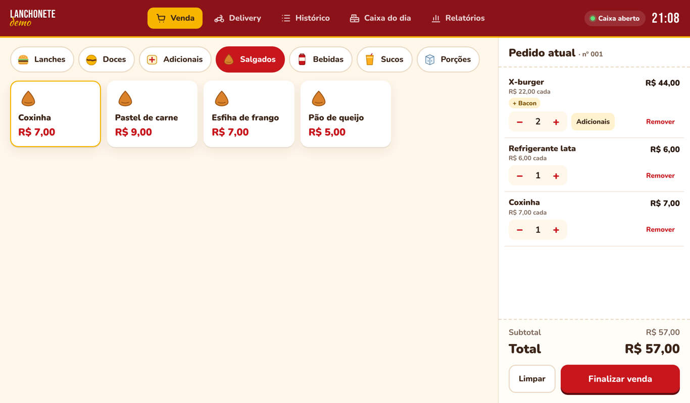
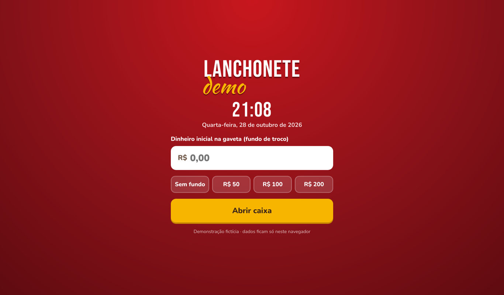
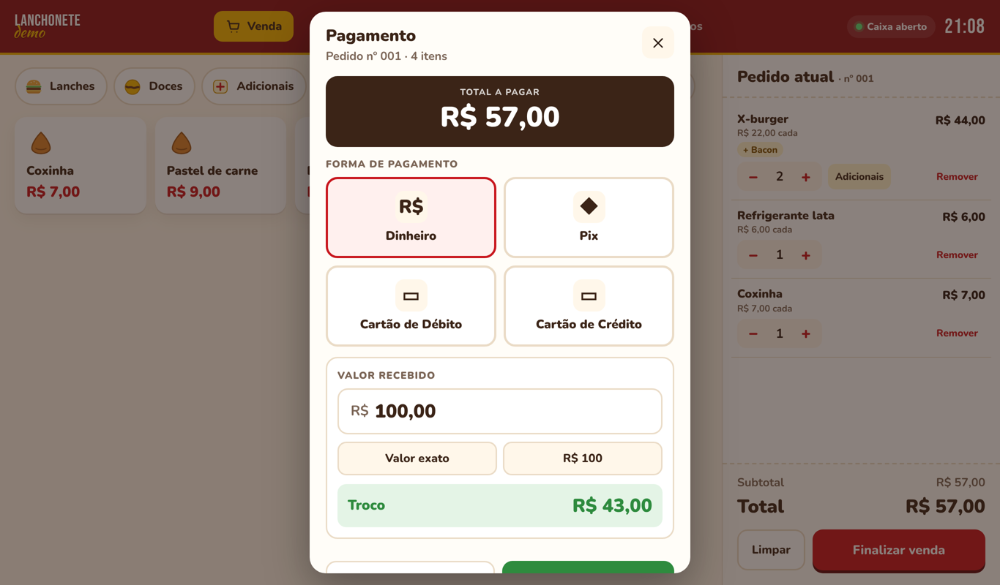
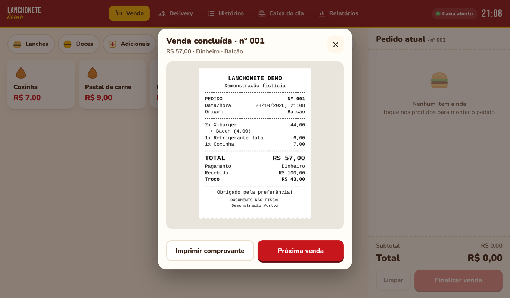
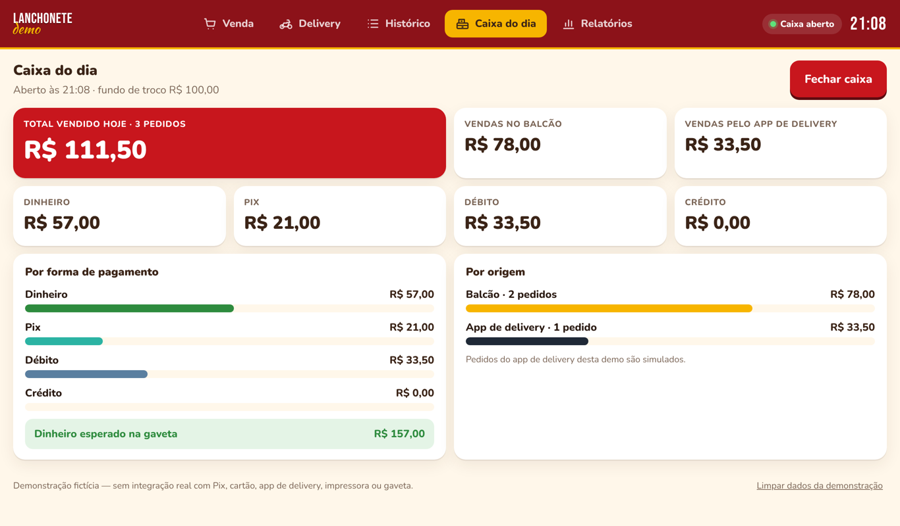
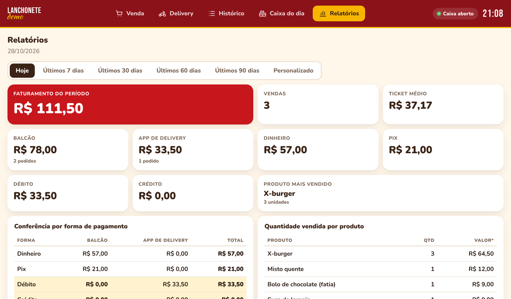
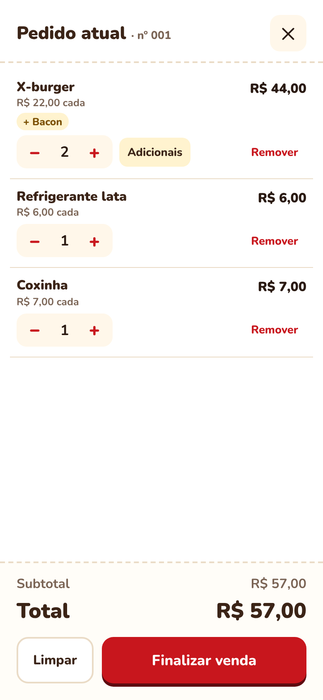

# Demo PDV · Lanchonete Demo

Demonstração fictícia de PDV (frente de caixa) para lanchonete, desenvolvida na Vortyx. Nome, cardápio e vendas são fictícios; pagamentos, gaveta, impressora e delivery são simulados.

**Demonstração online:** https://ruangdev0-ux.github.io/demo-pdv-lanchonete/



## Objetivo

Mostrar o fluxo completo de um caixa de balcão, da abertura ao fechamento do dia, em uma interface pensada para toque (tablet, computador ou celular), sem backend e sem instalação.

## Funcionalidades

1. Abertura de caixa com fundo de troco, data e hora
2. Venda por categorias (Lanches, Doces, Adicionais, Salgados, Bebidas, Sucos, Porções)
3. Lanches com adicionais opcionais (Bacon, Queijo extra, Ovo) e quantidade
4. Pedido atual: alterar quantidade, editar adicionais, remover item, limpar e finalizar
5. Pagamento em Dinheiro (com cálculo de troco), Pix, Débito ou Crédito, **simulados**
6. Abertura da gaveta, **simulada**
7. Comprovante em estilo bobina térmica, com impressão em 80 mm via `window.print()`
8. Pedido de app de delivery **simulado**: chega com aviso sonoro, pode ser aceito ou recusado e gera comanda
9. Histórico da sessão com filtro por origem (Balcão ou App de delivery)
10. Caixa do dia: totais por forma de pagamento e por origem, dinheiro esperado na gaveta
11. Fechamento de caixa com valor contado, diferença e resumo imprimível
12. Relatórios por período (hoje, 7, 30, 60, 90 dias ou intervalo personalizado): faturamento, ticket médio, conferência por forma de pagamento, produtos vendidos e lista de vendas com filtros

## Tecnologias

- HTML5, CSS3 (layout responsivo, impressão com `@media print`) e JavaScript puro (sem frameworks)
- `localStorage` para persistência no navegador
- Web Audio API para o aviso de novo pedido
- Fontes locais sob licença OFL, para funcionar offline

## Estrutura

```
index.html              página única do PDV
assets/css/styles.css   identidade visual, layout responsivo e estilos de impressão
assets/js/data.js       cardápio fictício (produtos, preços e adicionais)
assets/js/app.js        lógica do caixa, pagamentos, comprovantes e relatórios
assets/fonts/           fontes locais (OFL)
docs/screenshots/       telas da demonstração
```

## Dados e localStorage

Todo o estado (caixa aberto, pedido atual, vendas, fechamentos) fica no `localStorage` do navegador, na chave `demo-pdv-lanchonete-v1`. Não há servidor, banco de dados nem dados de clientes.

Ao fechar o caixa, as vendas do dia ficam arquivadas no próprio navegador e alimentam a tela **Relatórios**. O botão "Limpar dados da demonstração" (tela Caixa do dia) apaga tudo.

## Limitações

- Pix, cartões, gaveta, impressora e app de delivery são simulações; não há integração real
- Não emite documento fiscal (NF-e/NFC-e)
- Sem controle de estoque, cadastro de produtos pela interface ou módulo financeiro
- Os dados ficam apenas no navegador e aparelho em uso; em um sistema real seria necessário um banco de dados para histórico, backup e acesso em vários dispositivos

## Como executar

- **Online:** acesse a demonstração pelo link acima.
- **Local:** clone o repositório e abra o `index.html` no navegador (Chrome ou Edge). Não precisa de instalação nem de internet.

```bash
git clone https://github.com/ruangdev0-ux/demo-pdv-lanchonete.git
```

## Telas

| Abertura de caixa | Pagamento | Comprovante |
|---|---|---|
|  |  |  |

| Caixa do dia | Relatórios | Celular |
|---|---|---|
|  |  |  |
